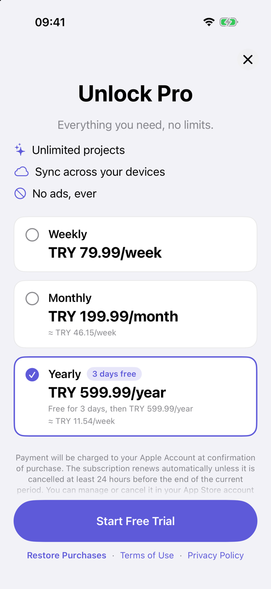

# PaywallKit

SwiftUI paywall components for iOS that are designed around Apple's App Store Review Guidelines.

PaywallKit gives you a complete, customizable paywall — plan cards, trial badge, restore button,
legal links and close button — and **enforces the rules that most often get subscription apps
rejected**, in code rather than in a checklist you have to remember.

- Swift 5.9+, iOS 16+, **no third-party dependencies**
- StoreKit 2 out of the box, or plug in RevenueCat / Adapty / your own backend via `PurchaseProvider`
- Light & dark mode, Dynamic Type, VoiceOver labels
- Localized in English and Turkish (String Catalog)

## Screenshots

| Light (English) | Light (Turkish) | Dark · Accessibility size |
| :---: | :---: | :---: |
| _screenshot placeholder_ | _screenshot placeholder_ | _screenshot placeholder_ |

<!-- Add images to docs/screenshots/ and reference them here, e.g.  -->

## What the rules look like in code

| App Review rule | How PaywallKit enforces it |
| --- | --- |
| **The billed amount is the most prominent price** (Guideline 3.1.2(c)) | `PlanCard` renders prices only through `PriceHierarchy`; there is no API to pass it arbitrary price text. The billed amount (`₺599,99/yıl`) is bold, primary color and the largest price style. Calculated equivalents (`≈ ₺11,54/hafta`) and trial descriptions are always regular weight, secondary color and a strictly smaller text style — `PriceTypography` lowers any style that would violate this. A weekly plan never shows a "weekly equivalent". |
| **The close button is visible immediately** | `CloseButton` is drawn unconditionally in the first frame: no delay, no fade-in, no option to hide it. 44×44 pt hit area, VoiceOver label. |
| **Restore, Terms and Privacy are always visible** | They live in a footer pinned to the bottom, outside the scroll view, and stay visible while loading, on error and while scrolling. `termsOfServiceURL` and `privacyPolicyURL` are non-optional. |
| **Subscription terms are disclosed** | `SubscriptionDisclosure` shows the auto-renewal text (and the free trial terms when applicable) under the plans. |
| **Trials state what is charged afterwards** | A trial plan shows "Free for 3 days, then $59.99/year" in addition to the billed amount. |

## Installation

### Swift Package Manager

In Xcode: **File ▸ Add Package Dependencies…** and enter:

```
https://github.com/enes-meral/PaywallKit
```

Or in `Package.swift`:

```swift
dependencies: [
    .package(url: "https://github.com/enes-meral/PaywallKit", branch: "main")
],
targets: [
    .target(name: "YourApp", dependencies: ["PaywallKit"])
]
```

## Usage

```swift
import PaywallKit
import SwiftUI

struct ContentView: View {
    @State private var showsPaywall = false

    var body: some View {
        Button("Go Pro") { showsPaywall = true }
            .fullScreenCover(isPresented: $showsPaywall) {
                PaywallView(
                    title: "Unlock Pro",
                    subtitle: "Everything you need, no limits.",
                    features: [
                        PaywallFeature(systemImage: "sparkles", title: "Unlimited projects"),
                        PaywallFeature(systemImage: "icloud", title: "Sync across devices")
                    ],
                    configuration: PaywallConfiguration(
                        productIDs: ["com.yourcompany.app.weekly", "com.yourcompany.app.yearly"],
                        termsOfServiceURL: URL(string: "https://example.com/terms")!,
                        privacyPolicyURL: URL(string: "https://example.com/privacy")!,
                        preselectedProductID: "com.yourcompany.app.yearly",
                        equivalentPriceUnit: .week   // optional, default is nil (no equivalent)
                    ),
                    onPurchase: { productID in
                        // Unlock content, then dismiss.
                        showsPaywall = false
                    },
                    onRestore: { productIDs in
                        // Unlock restored content.
                    }
                )
                .tint(.indigo)
            }
    }
}
```

`PaywallView` uses `StoreKitPurchaseProvider` by default. The close button calls
`@Environment(\.dismiss)` unless you pass `onDismiss`.

### Custom header

Replace the built-in title and feature list with any view. Keep prices out of the header — pricing
belongs in the plan cards, where the prominence rule is enforced.

```swift
PaywallView(configuration: configuration) {
    VStack(spacing: 12) {
        Image("Hero").resizable().scaledToFit().frame(height: 160)
        Text("Your title").font(.largeTitle.bold())
    }
}
```

### Building your own layout

All components are public and can be used on their own:

```swift
PlanCard(product: product, isSelected: true, equivalentUnit: .week) { select(product) }
TrialBadge(offer: .freeTrial(.days(3)))
RestoreButton { await restore() }
LegalLinks(termsURL: termsURL, privacyURL: privacyURL)
CloseButton { dismiss() }
SubscriptionDisclosure(product: selectedProduct)
```

`PriceFormatter` and `PriceHierarchy` are public too, if you need the formatted strings elsewhere.

### Price typography

```swift
PaywallConfiguration(
    ...,
    typography: PriceTypography(billed: .title, secondary: .footnote)
)
```

If `secondary` is not strictly smaller than `billed`, it is lowered automatically (with a debug
assertion). Use `PriceTypography.clamped(billed:secondary:)` to correct values silently, for
example when they come from remote config.

## Using RevenueCat or another backend

Conform to `PurchaseProvider` and pass your provider to `PaywallView`:

```swift
struct MyBackendProvider: PurchaseProvider {
    func loadProducts(ids: [String]) async throws -> [PaywallProduct] {
        // Map your SDK's products to PaywallProduct.
        // Only set `introductoryOffer` when the user is eligible for it.
    }

    func purchase(_ product: PaywallProduct) async throws -> PurchaseResult {
        // Purchase via your SDK; return .success(productID:), .pending or .userCancelled.
    }

    func restorePurchases() async throws -> RestoreResult {
        // Restore via your SDK; return .restored(productIDs:) or .nothingToRestore.
    }
}

PaywallView(title: "Unlock Pro", configuration: configuration, provider: MyBackendProvider())
```

`PreviewPurchaseProvider` returns fake products and never contacts the App Store — use it in
SwiftUI previews and tests.

## Listening to `Transaction.updates`

`StoreKitPurchaseProvider` verifies and finishes transactions started **from the paywall**. Some
transactions arrive outside of it: renewals, Ask to Buy approvals, refunds, purchases made on
another device, or offer codes redeemed in the App Store. StoreKit delivers these through
`Transaction.updates`, and Apple expects your app to listen from launch for its whole lifetime —
otherwise those transactions are never finished and the user's access can be wrong.

PaywallKit deliberately does not start this listener (it would only run while the paywall is on
screen). Add one to your app:

```swift
import StoreKit
import SwiftUI

@MainActor
final class EntitlementStore: ObservableObject {
    @Published private(set) var activeProductIDs: Set<String> = []
    private var updatesTask: Task<Void, Never>?  // lives as long as the app

    init() {
        updatesTask = Task { [weak self] in
            for await result in Transaction.updates {
                guard case .verified(let transaction) = result else { continue }
                await transaction.finish()
                await self?.refresh()
            }
        }
        Task { await refresh() }
    }

    func refresh() async {
        var ids = Set<String>()
        for await result in Transaction.currentEntitlements {
            if case .verified(let transaction) = result, transaction.revocationDate == nil {
                ids.insert(transaction.productID)
            }
        }
        activeProductIDs = ids
    }
}

@main
struct MyApp: App {
    @StateObject private var entitlements = EntitlementStore()

    var body: some Scene {
        WindowGroup {
            ContentView().environmentObject(entitlements)
        }
    }
}
```

Call `entitlements.refresh()` from `onPurchase` / `onRestore` as well.

## Localization

PaywallKit ships its own strings in English and Turkish (`Localizable.xcstrings`). The language
follows SwiftUI's `\.locale` environment value, which follows your app's localization. **Your app
must declare Turkish as a supported localization** (for example by having a `tr` entry in your
own String Catalog) — otherwise iOS runs your app in English and the paywall follows it, which
avoids a mixed-language screen. Unsupported languages fall back to English.

Product names come from the store (`displayName`), so localize them in App Store Connect.

## App Review Checklist

PaywallKit handles the items marked ✅. The rest depend on your app and your App Store Connect
setup.

- ✅ Billed amount is the most prominent price; calculated equivalents are small and secondary — 3.1.2(c)
- ✅ Close button is visible immediately, with no delay
- ✅ Restore Purchases is always visible
- ✅ Terms of Use and Privacy Policy links are always visible
- ✅ Auto-renewal and free trial terms are shown next to the plans — 3.1.2
- ✅ Trial plans state the price charged after the trial
- ✅ Intro offers are shown only to eligible users (with `StoreKitPurchaseProvider`)
- ⬜ Your Terms of Use (EULA) and Privacy Policy URLs work and are also set in App Store Connect
  (Privacy Policy URL field; standard Apple EULA or a custom one in the app description)
- ⬜ Product names and descriptions in App Store Connect clearly describe what the user gets
- ⬜ The custom header makes no price claims and no misleading "free" wording
- ⬜ Your app doesn't block core functionality that was promised for free, and the paywall can be
  dismissed everywhere you present it
- ⬜ You listen to `Transaction.updates` (see above) and unlock content right after purchase
- ⬜ You test with a StoreKit configuration file and in the sandbox before submitting

PaywallKit makes these rules hard to break, but it is not a guarantee of approval: App Review
looks at the whole app.

## Demo app

`Examples/PaywallKitDemo` contains a small demo app that uses fake products only:

```sh
open Examples/PaywallKitDemo/PaywallKitDemo.xcodeproj
```

- **Preview (fake)** provider — works anywhere, no store needed.
- **StoreKit (local .storekit)** provider — uses `PaywallKitDemo.storekit`, which the shared
  scheme activates when you run from Xcode.
- Launch arguments: `-showPaywall` opens the paywall on launch, `-useStoreKit` starts with the
  StoreKit provider.

The demo's bundle identifier is the placeholder `com.example.PaywallKitDemo`. Choose your own team
in Signing & Capabilities to run it on a device.

## Running the tests

The package is iOS-only, so tests run on a simulator:

```sh
xcodebuild test -scheme PaywallKit -destination 'platform=iOS Simulator,name=iPhone 17 Pro'
```

## License

PaywallKit is available under the MIT license. See [LICENSE](LICENSE).
