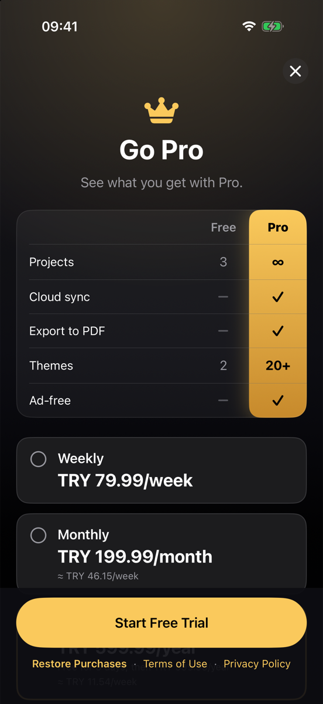
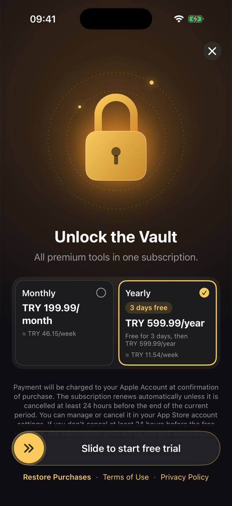
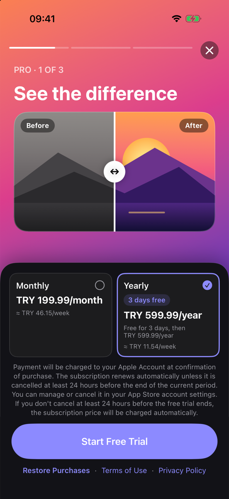
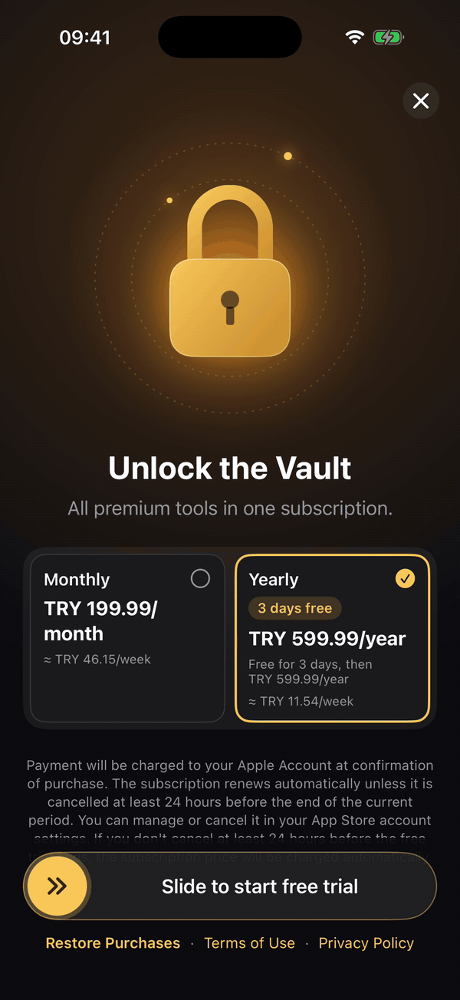
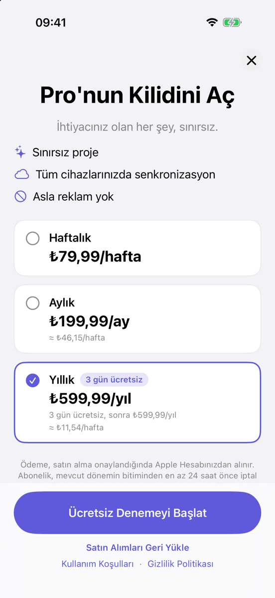
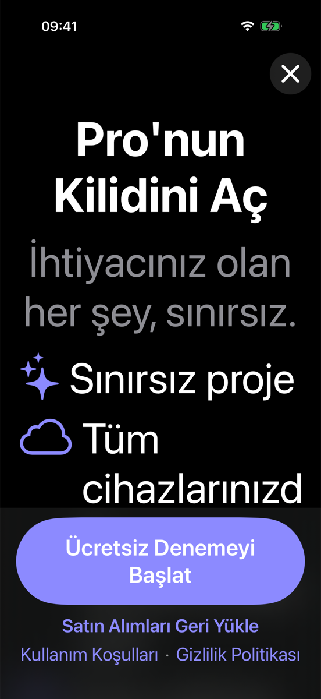

# PaywallKit

SwiftUI paywall components for iOS that are designed around Apple's App Store Review Guidelines.

PaywallKit gives you a complete, customizable paywall — plan cards, trial badge, restore button,
legal links and close button — and **enforces the rules that most often get subscription apps
rejected**, in code rather than in a checklist you have to remember.

- Swift 5.9+, iOS 16+, **no third-party dependencies**
- StoreKit 2 out of the box, or plug in RevenueCat / Adapty / your own backend via `PurchaseProvider`
- Four ready-made templates: `.classic`, `.comparison`, `.vault`, `.stories`
- Light & dark mode, Dynamic Type, VoiceOver labels, Reduce Motion
- Localized in English and Turkish (String Catalog)

| `.comparison` | `.vault` | `.stories` |
| :---: | :---: | :---: |
|  |  |  |

<p align="center">
  
</p>

## Screenshots (`.classic`)

| Light (English) | Light (Turkish) | Dark · Accessibility size |
| :---: | :---: | :---: |
|  |  |  |

_Screenshots from the demo app (fake products) on iPhone 17 Pro._

## What the rules look like in code

These guarantees hold for **every template**.

| App Review rule | How PaywallKit enforces it |
| --- | --- |
| **The billed amount is the most prominent price** (Guideline 3.1.2(c)) | `PlanCard` renders prices only through `PriceHierarchy`; there is no API to pass it arbitrary price text. The billed amount (`₺599,99/yıl`) is bold, primary color and the largest price style. Calculated equivalents (`≈ ₺11,54/hafta`) and trial descriptions are always regular weight, secondary color and a strictly smaller text style — `PriceTypography` lowers any style that would violate this. A weekly plan never shows a "weekly equivalent". |
| **The close button is visible immediately** | `CloseButton` is drawn unconditionally in the first frame: no delay, no fade-in, no option to hide it. 44×44 pt hit area, VoiceOver label. |
| **Restore, Terms and Privacy are always visible** | They live in an opaque area pinned to the bottom, outside the scroll view, and stay visible while loading, on error and while scrolling. The area is filled with the template's background color (with a 24 pt fade on top), so scrolled content never shows through it. `termsOfServiceURL` and `privacyPolicyURL` are non-optional. |
| **Subscription terms are disclosed** | `SubscriptionDisclosure` shows the auto-renewal text (and the free trial terms when applicable) either directly below the plans or fully visible in the pinned area — never cut off behind it. |
| **Trials state what is charged afterwards** | A trial plan shows "Free for 3 days, then $59.99/year" in addition to the billed amount. |

## Installation

### Swift Package Manager

In Xcode: **File ▸ Add Package Dependencies…** and enter:

```
https://github.com/enes-meral/PaywallKit
```

Or in `Package.swift`:

```swift
dependencies: [
    .package(url: "https://github.com/enes-meral/PaywallKit", from: "0.2.0")
],
targets: [
    .target(name: "YourApp", dependencies: ["PaywallKit"])
]
```

## Usage

```swift
import PaywallKit
import SwiftUI

struct ContentView: View {
    @State private var showsPaywall = false

    var body: some View {
        Button("Go Pro") { showsPaywall = true }
            .fullScreenCover(isPresented: $showsPaywall) {
                PaywallView(
                    title: "Unlock Pro",
                    subtitle: "Everything you need, no limits.",
                    features: [
                        PaywallFeature(systemImage: "sparkles", title: "Unlimited projects"),
                        PaywallFeature(systemImage: "icloud", title: "Sync across devices")
                    ],
                    configuration: PaywallConfiguration(
                        productIDs: ["com.yourcompany.app.weekly", "com.yourcompany.app.yearly"],
                        termsOfServiceURL: URL(string: "https://example.com/terms")!,
                        privacyPolicyURL: URL(string: "https://example.com/privacy")!,
                        preselectedProductID: "com.yourcompany.app.yearly",
                        equivalentPriceUnit: .week   // optional, default is nil (no equivalent)
                    ),
                    onPurchase: { productID in
                        // Unlock content, then dismiss.
                        showsPaywall = false
                    },
                    onRestore: { productIDs in
                        // Unlock restored content.
                    }
                )
                .tint(.indigo)
            }
    }
}
```

`PaywallView` uses `StoreKitPurchaseProvider` by default. The close button calls
`@Environment(\.dismiss)` unless you pass `onDismiss`.

### Custom header

Replace the built-in title and feature list with any view. Keep prices out of the header — pricing
belongs in the plan cards, where the prominence rule is enforced.

```swift
PaywallView(configuration: configuration) {
    VStack(spacing: 12) {
        Image("Hero").resizable().scaledToFit().frame(height: 160)
        Text("Your title").font(.largeTitle.bold())
    }
}
```

### Building your own layout

All components are public and can be used on their own:

```swift
PlanCard(product: product, isSelected: true, equivalentUnit: .week) { select(product) }
TrialBadge(offer: .freeTrial(.days(3)))
RestoreButton { await restore() }
LegalLinks(termsURL: termsURL, privacyURL: privacyURL)
CloseButton { dismiss() }
SubscriptionDisclosure(product: selectedProduct)
```

`PriceFormatter` and `PriceHierarchy` are public too, if you need the formatted strings elsewhere.

### Price typography

```swift
PaywallConfiguration(
    ...,
    typography: PriceTypography(billed: .title, secondary: .footnote)
)
```

If `secondary` is not strictly smaller than `billed`, it is lowered automatically (with a debug
assertion). Use `PriceTypography.clamped(billed:secondary:)` to correct values silently, for
example when they come from remote config.

## Templates

Pick a template with `style:`. The default is `.classic`, so existing code keeps working.
Every template keeps the same guarantees: prices only through `PriceHierarchy`, a close button
in the first frame, Restore / Terms / Privacy pinned outside the scroll area, and the
subscription disclosure next to the plans. Templates never use fake countdowns, fake reviews
or guilt-tripping copy.

### `.classic`

Header, vertical plan list, button. Follows light/dark mode and your `.tint`.

```swift
PaywallView(title: "Unlock Pro", features: features, configuration: configuration)
```

### `.comparison`

Dark background with gold accents, a Free vs. Pro table (the Pro column sits on a gold
strip), a vertical plan list and a gold button. The preselected plan is listed first and the
disclosure sits in the pinned area, so the table, the selected plan and the disclosure fit on
the first screen of an iPhone 17 Pro.

```swift
PaywallView(
    configuration: configuration,
    style: .comparison(rows: [
        ComparisonRow(title: "Projects", free: .text("3"), pro: .text("∞")),
        ComparisonRow(title: "Cloud sync", free: .notIncluded, pro: .included),
        ComparisonRow(title: "Ad-free", free: .notIncluded, pro: .included)
    ])
) {
    Text("Go Pro").font(.largeTitle.bold())
}
```

### `.vault`

Dark background, a glowing gold lock with two slowly rotating orbit rings, plans as a
two-part segment (designed for two products) and a slide-to-confirm control instead of a
button. Prices on the compact plan cards stay on one line: the billed amount shrinks to at most
80% (units are never abbreviated), and only while it stays larger than the secondary lines. Sliding past 85% plays a success haptic, opens the lock's shackle and starts the
purchase; releasing earlier springs the thumb back.

```swift
PaywallView(
    configuration: PaywallConfiguration(
        productIDs: ["com.yourcompany.app.monthly", "com.yourcompany.app.yearly"],
        termsOfServiceURL: termsURL,
        privacyPolicyURL: privacyURL
    ),
    style: .vault
) {
    Text("Unlock the Vault").font(.title.bold())
}
```

`SlideToConfirm` is public and works on its own:

```swift
SlideToConfirm(title: "Slide to confirm", buttonTitle: "Confirm") {
    await doTheThing()
}
```

### `.stories`

Full-screen pages on multi-color gradients with segmented progress bars. Each page lasts 5
seconds; tap the right side to go forward, the left side to go back, press and hold to pause.
Page content can be interactive (the demo has a before/after slider). Plans, disclosure, button
and links stay in an opaque, rounded bottom panel on every page, so users can buy before the
story ends. The `header` closure is not shown — the pages are the content.

```swift
PaywallView(
    configuration: configuration,
    style: .stories(pages: [
        PaywallStoryPage(caption: "Pro · 1 of 3", title: "Unlimited projects",
                         background: [.orange, .pink, .purple, .black]) {
            Image(systemName: "square.stack.3d.up.fill").font(.system(size: 64))
        },
        PaywallStoryPage(caption: "Pro · 2 of 3", title: "Sync everywhere",
                         background: [.teal, .black])
    ])
) {
    EmptyView()
}
```

### Accessibility and Reduce Motion

| | VoiceOver | Accessibility text sizes | Reduce Motion |
| --- | --- | --- | --- |
| All templates | Plan cards read as one element ("Yearly, $59.99 per year, …"); decorative art is hidden | Pinned footer and close button capped at `accessibility1` so they never cover the screen; plans stack vertically | — |
| `.vault` | `SlideToConfirm` becomes a regular button; the slider also supports the default action (double-tap) | `SlideToConfirm` becomes a regular button | Orbit rings don't rotate; the lock crossfades open instead of moving |
| `.stories` | No auto-advance; Previous / Next buttons appear | Plan area scrolls inside the fixed panel | No auto-advance (Previous / Next buttons), page changes crossfade |

Animations run only while the paywall is on screen (they stop in `onDisappear`). There is no
continuous `TimelineView` loop: the rings use a `repeatForever` rotation and the story progress
bar is a single linear animation per page.

## Using RevenueCat or another backend

Conform to `PurchaseProvider` and pass your provider to `PaywallView`:

```swift
struct MyBackendProvider: PurchaseProvider {
    func loadProducts(ids: [String]) async throws -> [PaywallProduct] {
        // Map your SDK's products to PaywallProduct.
        // Only set `introductoryOffer` when the user is eligible for it.
    }

    func purchase(_ product: PaywallProduct) async throws -> PurchaseResult {
        // Purchase via your SDK; return .success(productID:), .pending or .userCancelled.
    }

    func restorePurchases() async throws -> RestoreResult {
        // Restore via your SDK; return .restored(productIDs:) or .nothingToRestore.
    }
}

PaywallView(title: "Unlock Pro", configuration: configuration, provider: MyBackendProvider())
```

`PreviewPurchaseProvider` returns fake products and never contacts the App Store — use it in
SwiftUI previews and tests.

> **Note on `StoreKitPurchaseProvider`:** end-to-end verification against the StoreKit test
> server has not been done yet; the purchase logic was tested with `PreviewPurchaseProvider`.
> The demo project contains StoreKit integration tests (`PaywallKitDemoTests`), but they are
> skipped when the local StoreKit test environment is unavailable. Please open an issue with
> feedback.

## Listening to `Transaction.updates`

`StoreKitPurchaseProvider` verifies and finishes transactions started **from the paywall**. Some
transactions arrive outside of it: renewals, Ask to Buy approvals, refunds, purchases made on
another device, or offer codes redeemed in the App Store. StoreKit delivers these through
`Transaction.updates`, and Apple expects your app to listen from launch for its whole lifetime —
otherwise those transactions are never finished and the user's access can be wrong.

PaywallKit deliberately does not start this listener (it would only run while the paywall is on
screen). Add one to your app:

```swift
import StoreKit
import SwiftUI

@MainActor
final class EntitlementStore: ObservableObject {
    @Published private(set) var activeProductIDs: Set<String> = []
    private var updatesTask: Task<Void, Never>?  // lives as long as the app

    init() {
        updatesTask = Task { [weak self] in
            for await result in Transaction.updates {
                guard case .verified(let transaction) = result else { continue }
                await transaction.finish()
                await self?.refresh()
            }
        }
        Task { await refresh() }
    }

    func refresh() async {
        var ids = Set<String>()
        for await result in Transaction.currentEntitlements {
            if case .verified(let transaction) = result, transaction.revocationDate == nil {
                ids.insert(transaction.productID)
            }
        }
        activeProductIDs = ids
    }
}

@main
struct MyApp: App {
    @StateObject private var entitlements = EntitlementStore()

    var body: some Scene {
        WindowGroup {
            ContentView().environmentObject(entitlements)
        }
    }
}
```

Call `entitlements.refresh()` from `onPurchase` / `onRestore` as well.

## Localization

PaywallKit ships its own strings in English and Turkish (`Localizable.xcstrings`). The language
follows SwiftUI's `\.locale` environment value, which follows your app's localization. **Your app
must declare Turkish as a supported localization** (for example by having a `tr` entry in your
own String Catalog) — otherwise iOS runs your app in English and the paywall follows it, which
avoids a mixed-language screen. Unsupported languages fall back to English.

Product names come from the store (`displayName`), so localize them in App Store Connect.

## App Review Checklist

PaywallKit handles the items marked ✅. The rest depend on your app and your App Store Connect
setup.

- ✅ Billed amount is the most prominent price; calculated equivalents are small and secondary — 3.1.2(c)
- ✅ Close button is visible immediately, with no delay
- ✅ Restore Purchases is always visible
- ✅ Terms of Use and Privacy Policy links are always visible
- ✅ Auto-renewal and free trial terms are shown next to the plans — 3.1.2
- ✅ Trial plans state the price charged after the trial
- ✅ Intro offers are shown only to eligible users (with `StoreKitPurchaseProvider`)
- ⬜ Your Terms of Use (EULA) and Privacy Policy URLs work and are also set in App Store Connect
  (Privacy Policy URL field; standard Apple EULA or a custom one in the app description)
- ⬜ Product names and descriptions in App Store Connect clearly describe what the user gets
- ⬜ The custom header makes no price claims and no misleading "free" wording
- ⬜ Your app doesn't block core functionality that was promised for free, and the paywall can be
  dismissed everywhere you present it
- ⬜ You listen to `Transaction.updates` (see above) and unlock content right after purchase
- ⬜ You test with a StoreKit configuration file and in the sandbox before submitting

PaywallKit makes these rules hard to break, but it is not a guarantee of approval: App Review
looks at the whole app.

## Demo app

`Examples/PaywallKitDemo` contains a small demo app that uses fake products only:

```sh
open Examples/PaywallKitDemo/PaywallKitDemo.xcodeproj
```

- **Preview (fake)** provider — works anywhere, no store needed.
- **StoreKit (local .storekit)** provider — uses `PaywallKitDemo.storekit`, which the shared
  scheme activates when you run from Xcode.
- A **Template** picker switches between Classic, Comparison, Vault and Stories.
- Launch arguments: `-showPaywall` opens the paywall on launch, `-paywallStyle vault` (or
  `classic`, `comparison`, `stories`) picks the template, `-useStoreKit` starts with the StoreKit
  provider, `-slowProducts` makes the fake provider take 3 seconds to load, `-purchaseDelay 2.5`
  sets how long the fake provider takes to load and purchase.

The demo's bundle identifier is the placeholder `com.example.PaywallKitDemo`. Choose your own team
in Signing & Capabilities to run it on a device.

## Running the tests

The package is iOS-only, so tests run on a simulator:

```sh
xcodebuild test -scheme PaywallKit -destination 'platform=iOS Simulator,name=iPhone 17 Pro'
```

StoreKit integration tests for `StoreKitPurchaseProvider` live in the demo project. They use
`SKTestSession` with `PaywallKitDemo.storekit` and skip themselves, with an explicit message, when
the StoreKit test environment is not available on the machine:

```sh
xcodebuild test -project Examples/PaywallKitDemo/PaywallKitDemo.xcodeproj -scheme PaywallKitDemo \
  -destination 'platform=iOS Simulator,name=iPhone 17 Pro'
```

## License

PaywallKit is available under the MIT license. See [LICENSE](LICENSE).
